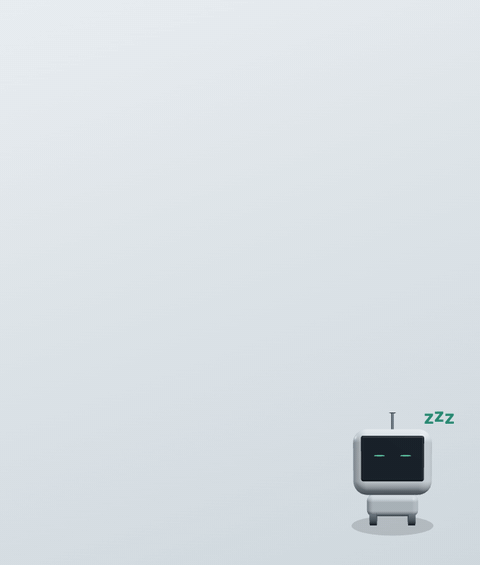
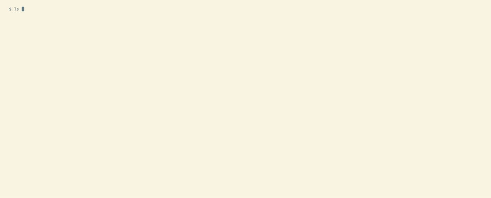
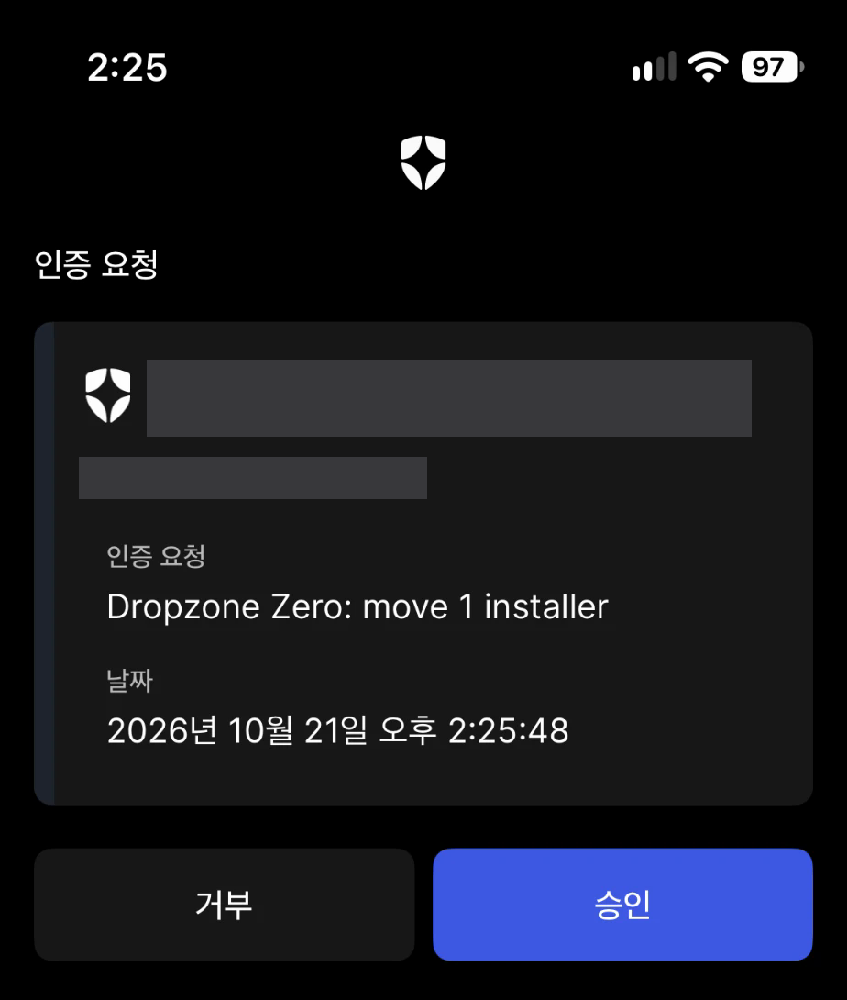
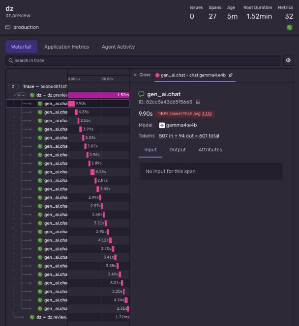
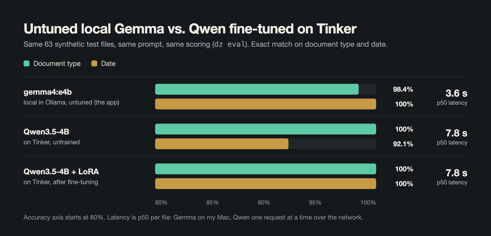

<h1 align="center">Dropzone Zero</h1>

<p align="center">
  <b>Every download filed the moment it lands, and every move one click from undone.</b><br>
  A local Gemma agent for your Downloads folder, with a small robot named Zee.
</p>

<p align="center">
  <a href="LICENSE"></a>
  <a href="package.json"></a>
  
  
</p>

<p align="center">
  <a href="#-quick-start"><b>Quick start</b></a> ·
  <a href="docs/guide/zee.md"><b>Zee</b></a> ·
  <a href="docs/guide/safety.md">Safety</a> ·
  <a href="docs/guide/rules.md">Your rules</a> ·
  <a href="#-benchmarks">Benchmarks</a> ·
  <a href="docs/guide/how-it-works.md">How it works</a>
</p>

<p align="center">
  
</p>

---

Receipts, booking confirmations, photos, manuals, and half-finished downloads pile up, because opening, renaming, and
moving each file by hand is tedious. Dropzone Zero reads each new download with **Gemma 4 running on your Mac**,
decides what it is, names it, and files it. Risky moves **wait for you**, in Zee or on your phone. Every move is
**hash-checked and journaled**, so one click puts any of it back, byte for byte.

```
scan0001.pdf  ->  Finance/Receipts/2026-10/2026-10-08-metro-cab-co-trip-receipt.pdf
IMG_2041.jpg  ->  Finance/Receipts/2026-10/2026-10-11-juniper-market-receipt.jpg   (a photo of a receipt)
invite.ics    ->  Calendar/2026-10-29-local-open-source-meetup-invite.ics
```

Free and MIT-licensed. The core needs no account or API key, and your files never leave the machine.

> Built for the [Hacktoberfest 2026 DEV Challenge](https://dev.to/challenges/hacktoberfest-week3-2026-10-19) (Week 3, "Slow and Steady").

## ✨ Why Dropzone Zero

| | |
|---|---|
| 🏠 **Your files stay on your Mac** | Gemma 4 (`gemma4:e4b`) reads text, PDFs, Office files, and photos through Ollama, locally. Cloud services only ever see synthetic test data, a label like "move 1 installer", or counts. |
| 🧾 **The model reads; code files** | Gemma answers in strict JSON: a kind, the date printed in the document, a title. Code builds the name and folder, and a date stays only if it is really written in the file. |
| 🛑 **Allow, ask, or block** | A guard judges every move before it runs. Installers and unsure guesses wait for you; moves out of the folder, into hidden folders, or that change a file's type never run. |
| ↩️ **Undo is exact** | Each file moves only if its SHA-256 still matches the preview, and is hashed again after. Every rename is journaled, so `dz undo` or **Undo last** restores it. Nothing is ever deleted. |
| 🤖 **No terminal needed** | Zee sits in a corner of the screen, shows what it is doing, asks with **Move it** / **Leave it**, and is the only thing you launch. |
| 📱 **Asks on your phone** | With Auth0 CIBA, the same question arrives as a Guardian push. Only the kind of move leaves the machine. |
| 🗂 **Your own rules** | A `.dropzonerules.json` sets where each kind of file goes and how it is named, and the guard still checks every move. |
| 🔎 **Find it by describing it** | "photo of a receipt from a market" finds the right file, using Gemma's image descriptions and EmbeddingGemma, all local. |

## 📸 Screenshots

| | |
|---|---|
|  |  |
| **The CLI**: preview, run, and undo on synthetic downloads | **Zee hiding**: it dives into a hole, and pops back out when called |
|  |  |
| **Phone approval**: the real push for a synthetic installer (account covered) | **Tracing**: one span per Gemma call, tokens and timing, never the prompt |

## 🚀 Quick start

Requires Node.js 22.9 or newer, [pnpm](https://pnpm.io), and [Ollama](https://ollama.com) for the local model. The
optional review gate also needs [uv](https://docs.astral.sh/uv/).

```bash
pnpm install
ollama pull gemma4:e4b  # about 6.6 GB, once
ollama serve            # skip if the Ollama app is already running
pnpm seed               # creates demo/inbox with 31 synthetic files
pnpm seed:history       # optional: synthetic past decisions for the review gate
pnpm dz preview demo/inbox
pnpm dz run demo/inbox      # asks before moving anything
pnpm dz undo demo/inbox     # puts every file back
```

On an Apple Silicon laptop the 31-file demo preview takes about 70 to 100 seconds with `gemma4:e4b`, most of it spent
looking at images. On a real Downloads folder with larger PDFs and photos, expect about 5 seconds per file. Gemma 4
thinks before answering by default; Dropzone Zero turns that off, because for one-file classification it was about 15
times slower with no better answers.

For the desktop app, which starts Ollama and the background daemon for you:

```bash
pnpm app:build                        # builds Zee.app (about 10 MB) with Tauri
pnpm dz autostart enable ~/Downloads   # Zee starts now and at every login
```

All commands: [Commands and everyday use](docs/guide/commands.md).

## 📊 Benchmarks

| What | Result | How |
|---|---|---|
| Classifier, 63 synthetic test files | **98.4%** kind, **100%** date, 0% invalid, p50 3.6 s | `dz eval`, local `gemma4:e4b` |
| Qwen3.5-4B fine-tuned on Tinker (a control) | 100% kind, date **92.1% → 100%** after LoRA | `ml/finetune.py`, scored by `dz eval --provider replay` |
| Korean titles (the first eval run's bug) | **85.7% → 98.4%** after fixing ASCII-only names | `dz eval` |
| Search, 7 test questions on the demo folder | **7/7** put the right file first | `dz find` |
| Receipts to CSV, demo folder | **6/6** receipts and invoices right | `dz receipts` |
| A run killed after 15 of 30 files | **30 moved, 0 failed** after `dz worker` resumed it | `dz run --temporal` |

<p align="center">
  
</p>

Every test file is synthetic, and the set was written alongside the app, so treat these as
regression checks, not accuracy claims. Three models landing between 98% and 100% also means the set is too easy to
tell good models apart. Details: [Measuring the classifier](docs/guide/how-it-works.md#measuring-the-classifier).

## 🧠 How it works

```
new download
  → rules: still downloading? → skip · empty, duplicate (same SHA-256), temp? → quarantine
  → Gemma 4 (Ollama, local) reads it → strict JSON: kind, printed date, title, confidence
  → code builds the name and folder (defaults or .dropzonerules.json); a date stays only if printed in the file
  → guard: ALLOW · REVIEW (Zee, terminal, or phone) · BLOCK   + TabPFN: "will you undo this?"
  → harness: judge again, check hash, rename, hash again, journal → undo from the journal
```

* **The model proposes, the guard decides.** No file name or document text is ever treated as an instruction; the
  worst a hostile document can do is get itself misfiled.
* **The harness trusts nothing before it.** It re-checks every move against the disk, never overwrites, follows no
  symbolic links, and refuses a plan edited by anything but Dropzone Zero.
* **It learns what you undo.** Single-file undos teach a local [TabPFN](https://priorlabs.ai) review gate, from
  metadata only, which moves to ask about next time.
* **Private by default.** Telemetry is off unless you set `SENTRY_DSN`, and even then file names, paths, prompts, and
  contents are never sent.

Deep dive: [How it works](docs/guide/how-it-works.md) and [Safety](docs/guide/safety.md).

## 📚 Guides

| Guide | What's in it |
|---|---|
| [Commands](docs/guide/commands.md) | Every `dz` command, `dz tidy` (Mastra), watching a folder, start at login, durable runs with Temporal |
| [Safety](docs/guide/safety.md) | ALLOW / REVIEW / BLOCK, how a run stays safe, what each part can touch, `.dropzoneignore`, the TabPFN review gate |
| [Your rules](docs/guide/rules.md) | `.dropzonerules.json`: where each kind of file goes and how it is named |
| [Zee](docs/guide/zee.md) | The desktop companion, what its faces mean, approving from your phone with Auth0 |
| [Search](docs/guide/search.md) | Finding a file by describing it, with Gemma captions and EmbeddingGemma |
| [Follow-ups](docs/guide/follow-ups.md) | Calendar events for invoices, bookings, and warranties; receipts to CSV |
| [How it works](docs/guide/how-it-works.md) | How a plan is made, settings, the classifier eval and the Tinker control, telemetry, demo data, roadmap |

## ❓ FAQ

<details><summary><b>Does anything leave my machine?</b></summary>

Not your files. Reading, describing, and searching all run on Ollama locally. The optional parts send only what the
table in [Safety](docs/guide/safety.md#what-each-part-can-touch) lists: a label such as "move 1 installer" for a phone
approval, a sentence of kinds and counts for the voice, counts and timings for telemetry.
</details>

<details><summary><b>Will it delete anything?</b></summary>

No. Duplicates and temp files go to `.dropzone/quarantine` inside the folder, which only you empty. Everything else
is a rename, and undo puts it back.
</details>

<details><summary><b>What if it files something in the wrong place?</b></summary>

Click **Undo last** in Zee, or run `dz undo`. `dz undo --file <name>` puts back a single file and teaches the review
gate that this kind of move was wrong.
</details>

<details><summary><b>Can I choose the folders and names?</b></summary>

Yes. List only the kinds you want to change in a `.dropzonerules.json`; see [Your rules](docs/guide/rules.md). A rule
that points outside the folder or into a hidden one stops the run with a message.
</details>

<details><summary><b>Does it need a GPU or the internet?</b></summary>

No GPU beyond what Ollama uses on your Mac, and no internet after the one-time model download.
</details>

## ⚠️ Limitations

* **macOS only, so far.** Zee, start at login, notifications, and calendar removal use macOS features, and that is the
  only system it has been tested on.
* **Scans with no text layer** are classified by name and size only, and a photographed invoice gets no due-date
  reminder, because due dates are read from text.
* **The test set is too easy** to separate good models; it needs messier documents before fine-tuning Gemma itself
  makes sense.

## 📄 License

[MIT](LICENSE). Zee bundles [three.js](https://threejs.org) (MIT).

**Built with PriorLabs-TabPFN.** The review gate uses the TabPFN v2 weights under
the [Prior Labs License](https://huggingface.co/Prior-Labs/TabPFN-v2-clf/blob/main/LICENSE.txt).
